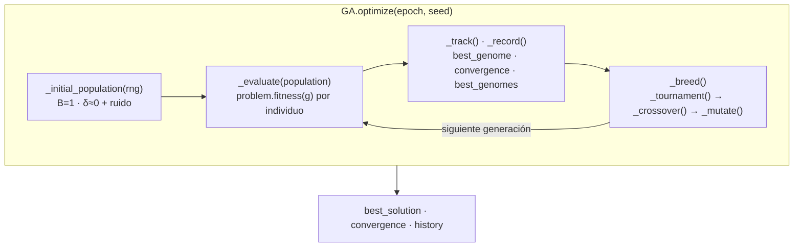
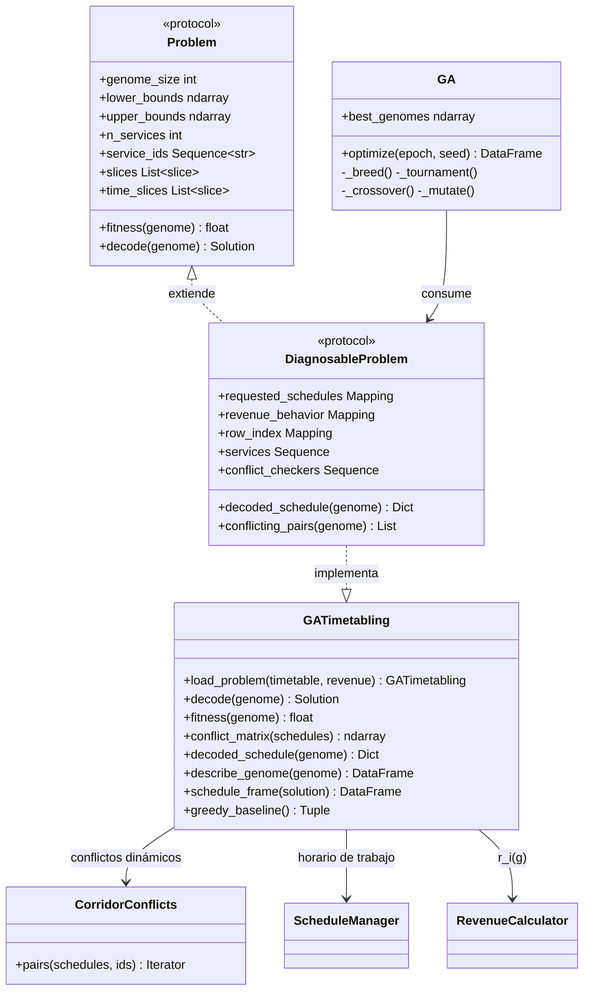
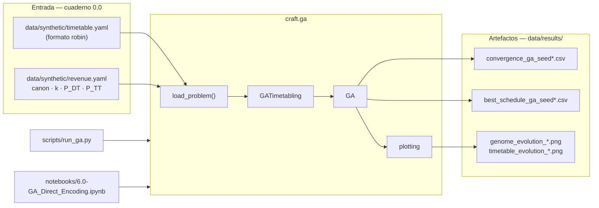
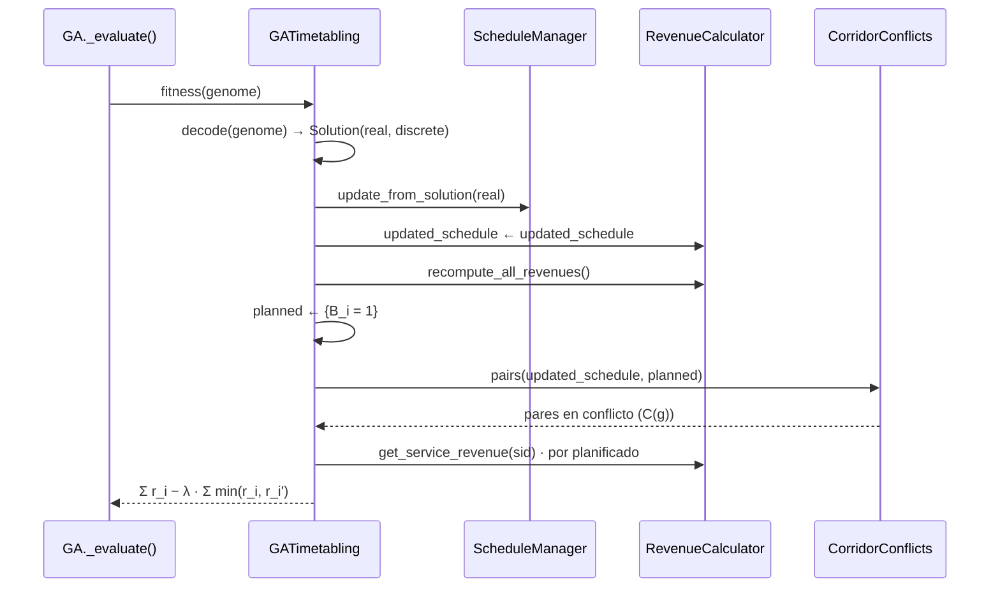

# Enfoque GA con codificación directa — Formulación y conexión con el código

Este documento describe de forma detallada el planteamiento del problema de
optimización (maximización del revenue del **IM**, *Infrastructure Manager*)
implementado en `src/craft/ga/`, y su relación con el paper de referencia
*“An approach to the timetabling problem in deregulated railway markets based
on metaheuristic algorithms”* (`docs/papers/TimetablingProblemRailway`).
Se mantiene **la misma notación del paper** ($SS$, $B_i$, $DT$/$ODT$,
$ca_i$, $k_i$, $\alpha_i$, $\beta_{ijk}$, $\delta$, $\Delta_{\max}$, $\omega$,
$\tau$, $\sigma$, $C_{i,i'}$, $FSS$) para que quien ya lo ha leído pueda
seguirlo directamente; cada ecuación y restricción se enlaza con la función,
método o clase que la materializa.

Las **decisiones de diseño** se marcan a lo largo del texto como esta:

> **Decisión de diseño.** …y a continuación se explica qué se decidió, entre
> qué alternativas y por qué.

**Cómo leer este documento.** Las secciones 1–5 formalizan el problema (qué
se decide, cómo se interpreta un individuo, qué se maximiza y qué se
respeta); las secciones 6–8 describen el solucionador y el flujo de trabajo;
las secciones 9–11 recogen la condición de conflicto exacta, los resultados
de referencia y el mapa del código. Cada bloque de ecuaciones va precedido
de su motivación en prosa y seguido de su implementación; los diagramas
Mermaid van acompañados de una lectura guiada.

---

## 1. Correspondencia de notación con el paper

En el paper, el IM recibe de los RUs (*Railway Undertakings*) un conjunto de
solicitudes $SS=\{S_1,\dots,S_{|SS|}\}$ — cada una con su ruta, sus horarios
y el canon $ca_i$ que el RU pagaría si se planificara tal cual — y debe
decidir qué servicios planifica ($B_i$) y con qué horarios actualizados
($\tilde dt_i^j$, el vector $ODT$), maximizando su beneficio y respetando
márgenes, tiempos de operación y headways. Este enfoque conserva ese modelo
económico y esas restricciones al completo; lo que cambia es **cómo se
representa la decisión y quién la toma** durante la búsqueda.

La tabla resume la correspondencia símbolo a símbolo y su ubicación en el
código; los tres cambios de fondo se comentan justo debajo.

| Paper | Concepto | En este enfoque | Código |
|---|---|---|---|
| $SS=\{S_1,\dots,S_{|SS|}\}$ | solicitudes de los RUs | la instancia sintética (50 servicios M→B) | `GATimetabling.services` |
| $S_i=\{(Sta_i^j, at_i^j, dt_i^j)\}$ | horario solicitado | horarios **congelados** (nunca mutan) | `problem.requested_schedules` |
| $B_i$ | servicio planificado (Ec. 1) | **gen explícito** del individuo | primer gen de `problem.slices[i]` |
| $DT$ / $ODT$ | vector de salidas / optimizado | genoma de deltas → acumulados → $\tilde dt_i^j$ | genoma, `cumulative_shifts()`, `decode()` |
| $dt_i^j$ / $\tilde dt_i^j$ | salida solicitada / actualizada | referencia + desplazamiento acumulado | `requested_schedules` / `updated_schedule` |
| $\delta$ | margen de modificación del IM (60 min) | cota del delta de origen y normalizador de penalización | `im_mod_margin` |
| $\Delta_{\max}$ | extensión máxima de parada (10 min) | tope superior de los acumulados | `max_stop_time` |
| $\tau_i^{j}$, $\sigma_i^j$ | tiempos de marcha y parada | invariantes garantizados por el arrastre | `operational_times`, `dwells` |
| $\omega$ | headway de seguridad (10 min; proxy del régimen de señalización/protección, §9) | umbral $2\omega$ de la condición de conflicto | `safe_headway` |
| $ca_i$, $k_i$, $P_{DT_i}$, $P_{TT_i}$ | canon y penalizaciones máximas | idénticos (fichero `revenue.yaml`) | `revenue_behavior`, `RevenueCalculator`, `penalty_function()` |
| $\alpha_i$, $\beta_{ijk}$, $x_{DT}$, $x_{TT}$ | pesos de desvío (Ecs. 8–11) | idénticos | `RevenueCalculator.get_service_revenue()` |
| $C_{i,i'}$ | indicador de conflicto (Ec. 7) | **dinámico** sobre el horario decodificado | `CorridorConflicts.pairs()` → `conflict_matrix()` |
| $FSS$ | horario final | horario decodificado del mejor individuo | `decoded_schedule()` |
| heurística (Algoritmo 1) | construcción de $B$ tras optimizar | baseline comparador (fuera del bucle) | `greedy_baseline()` |

Los tres cambios de fondo, con su motivación:

1. **$B_i$ pasa a ser variable de búsqueda.** En el paper, el metaheurístico
   solo mueve tiempos; *después*, el Algoritmo 1 (greedy) decide qué
   servicios entran en el horario. Esa heurística es miope: siempre salva al
   servicio más rentable de cada conflicto sin poder “mover” nada, y su
   resultado no es óptimo en general. Aquí el bit de planificación es un gen
   más del individuo, de modo que **qué servicios operar** y **con qué
   horarios** se optimizan a la vez — que es exactamente lo que sugiere la
   formulación matemática del paper (Ec. 1), donde $B_i$ ya aparece como
   variable binaria.

2. **Conflictos dinámicos.** La implementación previa calculaba la matriz de
   conflictos una sola vez con los horarios solicitados; en consecuencia,
   desplazar tiempos no podía eliminar ningún conflicto durante la búsqueda
   y la solución óptima tendía a “no desviar nada”. Este enfoque recalcula
   los conflictos sobre el horario decodificado ($ODT$), que es lo que la
   narrativa del paper describe en su paso 4. Es la pieza que hace que
   *mover* un horario tenga valor real: en el ejemplo del propio paper,
   adelantar dos servicios 30 minutos hace factibles tres solicitudes que
   chocaban.

3. **Sin heurística en el bucle: penalización pura.** Si dos servicios
   planificados entran en conflicto, la función objetivo lo penaliza
   (sección 3) en lugar de llamar a la heurística para reparar el individuo.
   El GA debe **aprender** a proponer combinaciones factibles. La heurística
   del paper no se pierde: se conserva como `greedy_baseline()` y sirve de
   referencia con la que comparar la calidad del GA.

> **Decisión de diseño.** El modelo económico (canon, curvas de penalización,
> sensibilidades por RU) se reutiliza sin ningún cambio. Toda la novedad está
> en la representación de la decisión y en el tratamiento de conflictos, no
> en el modelo de ingresos: así los resultados son directamente comparables
> con los del paper.

---

## 2. Individuo y decodificación

Esta sección define el individuo del GA — qué genes lo componen, con qué
cotas y por qué esa representación — y la regla de decodificación que los
convierte en un horario factible. Es el corazón del enfoque: la decodificación
garantiza por construcción las restricciones temporales, de modo que el GA
solo tenga que preocuparse por el revenue y los conflictos.

### 2.1 Qué codifica un individuo

> **Decisión de diseño.** Deltas relativos a la solicitud, no tiempos
> absolutos. Tres razones: (1) el gen $\delta = 0$ significa *“el horario que
> pidió el RU”*, que es el punto de partida natural y el de penalización
> nula; (2) las cotas del genoma son uniformes y legibles
> ($\pm\delta$ en el origen, $[0, \Delta_{\max}]$ aguas abajo) en lugar de
> horas absolutas distintas por estación; (3) la penalización del paper se
> calcula sobre la desviación $|\tilde dt - dt|$, que se lee directamente de
> los genes.

> **Decisión de diseño.** Minutos enteros. La resolución natural de un
> horario es el minuto; el flujo previo ya truncaba a entero al evaluar; y
> con genes enteros las condiciones de conflicto no sufren ruido flotante.

> **Decisión de diseño.** Un **bloque por servicio**: `[B_i, δ…]` contiguos.
> Así el cruce puede intercambiar servicios completos (sección 6) sin
> mezclar jamás el bit de planificación de un servicio con los deltas de
> otro. Los deltas de un servicio no planificado son *genes muertos*: no
> afectan al fitness y su fila aparece atenuada en las vistas.

Cada individuo es un vector de **enteros** (minutos) con un bloque por
servicio, en el orden de `problem.service_ids`:

$$
g = \big[\, B_1, \delta_1^1, \dots, \delta_1^{n_1-1} \;\big|\; \dots \;\big|\;
B_{|SS|}, \delta_{|SS|}^1, \dots, \delta_{|SS|}^{n_{|SS|}-1} \,\big]
$$

- $B_i \in \{0,1\}$: ¿se planifica el servicio $i$? (primer gen del bloque).
- $\delta_i^j \in \mathbb{Z}$: delta en minutos sobre $dt_i^j$ (la salida
  solicitada); $0$ = sin cambio.
- Hay un gen por estación **con salida** ($n_i - 1$ por servicio): la última
  estación es destino y no tiene salida — su llegada se deriva en la
  decodificación. Esto replica la estructura de variables del flujo previo
  (el $DT$ del paper ya excluía la última estación).

Por ejemplo, un servicio directo Madrid→Barcelona cuyo RU pide salir a las
10:32 tendría el bloque $[B, \delta^{1}]$ (un solo delta: el del origen), y
un servicio con paradas en Guadalajara, Calatayud, Zaragoza, Lleida y Camp
de Tarragona tendría $[B, \delta^1, \dots, \delta^6]$ (origen + cinco
paradas intermedias).

El layout completo del genoma — qué genes pertenecen a qué servicio y qué
cotas tiene cada uno — lo calcula `GATimetabling._build_genome_layout()`, que
expone `slices`, `time_slices`, `real_slices`, `lower_bounds` y
`upper_bounds`. Para la instancia de referencia (50 servicios): 217 genes =
50 bits $B$ + 167 deltas.

### 2.2 Decodificación por arrastre acumulado

La idea central del enfoque: **el delta de cada estación se acumula sobre
todas las estaciones posteriores**. Si un tren sale 5 minutos tarde del
origen, no puede llegar *antes* a la siguiente estación: los 5 minutos se
arrastran. Esta regla única reproduce las restricciones de operación del
paper sin necesidad de reparaciones.

Notación: denotaremos por $s_i^j$ el **desplazamiento acumulado** (en inglés,
*cumulative shift*) de la estación $j$ del servicio $i$ — cuántos minutos
respecto de lo solicitado lleva ya añadidos el tren al salir de ella —, de
modo que el horario decodificado es simplemente $\tilde dt_i^j = dt_i^j +
s_i^j$. Las ecuaciones de decodificación quedan:

$$
s_i^1 = \mathrm{clip}\big(\delta_i^1,\; -\delta,\; +\delta\big)
$$

**Lectura de la primera ecuación.** El delta de la estación origen es el
único que puede ser negativo (adelantar la salida) o positivo (retrasarla),
siempre dentro del margen de modificación del IM $\delta$ (±60 min en la
instancia): es la restricción de intervalo de salida del paper, Ec. (2).
El desplazamiento del origen es, por tanto, $s_i^1 = \delta_i^1$.

$$
s_i^j = \mathrm{clip}\Big(s_i^{j-1} + \delta_i^j,\;\; s_i^{j-1},\;\;
\min\big(\Delta_{\max},\; s_i^{j-1} + \Delta_{\max} - \sigma_i^j\big)\Big),
\qquad j = 2,\dots,n_i-1
$$

**Lectura de la segunda ecuación**, término a término:

- $s_i^{j-1} + \delta_i^j$ es el *deseo*: lo que ya venía arrastrado más el
  retraso extra que se pide en la estación $j$.
- La **cota inferior** $s_i^{j-1}$ es la restricción de tiempos de
  operación (Ec. 3 del paper): la salida de la estación $j$ no puede ser
  anterior a la llegada del tren, así que el desplazamiento nunca puede
  bajar. En términos de deltas equivale exactamente a exigir
  $\delta_i^j \ge 0$ — véase 2.3.
- La **cota superior** $\min(\Delta_{\max},\, s_i^{j-1} + \Delta_{\max} -
  \sigma_i^j)$ implementa las dos restricciones de dwell del paper: la Ec.
  (4) ($\tilde dt_i^j \le dt_i^j + \Delta_{\max}$, el primer sumando) y la
  Ec. (5) ($\tilde dt_i^j \le \tilde dt_i^{j-1} + \tau + \Delta_{\max}$, el
  segundo sumando). Si el deseo las viola, la salida simplemente se queda en
  el tope: el tren sale en cuanto puede.

Y finalmente el horario decodificado y la llegada a destino:

$$
\tilde dt_i^j = dt_i^j + s_i^j
\qquad\qquad
\tilde at_i^{n_i} = \tilde dt_i^{n_i-1} + \tau_i^{n_i-1}
$$

**Implementación**: `cumulative_shifts(deltas, dwells, im_mod_margin,
max_stop_time)` computa los desplazamientos acumulados $s$ (función pura, fácil de
testear), y `GATimetabling.decode(genome)` los aplica a los horarios
solicitados y devuelve el `Solution` estándar del framework (`real` = tiempos
absolutos para `ScheduleManager`, `discrete` = máscara $B$).

### 2.3 Ejemplo desarrollado paso a paso

Tomemos el ejemplo de partida. Servicio con salidas solicitadas
$dt = (8{:}00,\ 9{:}00,\ 10{:}00)$ — es decir, origen más dos paradas
intermedias con salida; el destino final se deriva — y el bloque del
individuo $[B, \delta] = [1,\ 5,\ 0,\ 1]$, con dwells originales
$\sigma = (2, 2)$ min y $\delta = 60$, $\Delta_{\max} = 10$:

| Paso | Cálculo | Resultado | Lectura |
|---|---|---|---|
| $s^1$ | $\mathrm{clip}(5, -60, 60)$ | **5** | el origen sale a las **8:05** |
| $s^2$ | $\mathrm{clip}(5+0,\ 5,\ \min(10,\ 5+10-2)) = \mathrm{clip}(5,5,10)$ | **5** | la parada 1 sale a las **9:05**: el +5 del origen arrastra y el $\delta=0$ no añade nada |
| $s^3$ | $\mathrm{clip}(5+1,\ 5,\ \min(10,\ 5+10-2)) = \mathrm{clip}(6,5,10)$ | **6** | la parada 2 sale a las **10:06**: los +5 arrastrados más +1 propios |

Horario decodificado: **8:05, 9:05, 10:06** — los 6 minutos se han repartido
respetando marcha (60 min entre estaciones, inalterada) y paradas (cada dwell
crece como mucho lo que su delta permita). Este caso exacto está fijado como
test: `tests/test_ga.py::test_cumulative_shifts_example`.

Un segundo ejemplo con **adelanto**: bloque $[1, -30, 5, 5]$, $\sigma=(2,2)$:

- $s^1 = -30$ → el origen sale a las 7:30 (adelanto permitido hasta −60).
- $s^2 = \mathrm{clip}(-30+5,\ -30,\ \min(10, -30+10-2)) =
  \mathrm{clip}(-25, -30, -22) = -25$ → sale 25 minutos antes que lo
  solicitado; el tren no puede ganar tiempo, solo repartir el adelanto.
- $s^3 = \mathrm{clip}(-25+5,\ -25,\ \min(10, -25+10-2)) = -20$ → los
  acumulados son no decrecientes $(-30 \le -25 \le -20)$: nunca se acorta un
  tramo.

### 2.4 Factibilidad por construcción

La equivalencia que hace viable todo el enfoque: con $\delta_i^j \ge 0$
($j \ge 2$), el tiempo entre salidas consecutivas decodificadas es

$$
\tilde dt_i^j - \tilde dt_i^{j-1} = (dt_i^j - dt_i^{j-1}) + (s_i^j - s_i^{j-1})
= (\tau_i + \sigma_i) + \delta_i^j \;\ge\; \tau_i + \sigma_i,
$$

que es *exactamente* la restricción de tiempos de operación del paper (Ec.
3). Es decir: la cota inferior de los deltas **no descarta ninguna solución
factible** — es la restricción escrita en otra coordenada — y elimina de
raíz toda la familia de individuos infactibles que el enfoque anterior
tenía que descartar en evaluación (servicio con parada encogida → revenue
cero → evaluación desperdiciada). El dwell decodificado queda
$\sigma_i^j + \delta_i^j \ge \sigma_i^j$: las paradas nunca se acortan.

> **Decisión de diseño.** Origen con retraso limitado en multi-parada.
> Combinando las cotas 3 y 2: $s^2 \ge s^1$ y $s^2 \le \Delta_{\max}$
> fuerzan $s^1 \le \Delta_{\max}$. Es decir, **en un servicio con paradas
> intermedias no se puede retrasar el origen más de $\Delta_{\max}$** (con
> $\sigma$ pequeñas, no hay hueco para “colocar” ese retraso sin violar el
> tope de dwell). Por eso el gen de origen acota su retraso a
> $\min(\delta, \Delta_{\max})$ en multi-parada y conserva el margen completo
> $\pm\delta$ en directos (sin intermedios no hay dwell que choque).
> Ejemplo numérico del choque que se evita: origen $+50$ con
> $\Delta_{\max}=10$ obligaría a que la parada intermedia saliera como muy
> tarde $+10$ sobre lo solicitado… pero el tren llega $+50$: dwell negativo,
> infactible. Implementado en `GATimetabling._origin_delta_upper()`.

En resumen, la decodificación garantiza **sin heurística ni reparación** las
restricciones 1–5 de la sección 4; el único aprendizaje que le queda al GA es
evitar conflictos (sección 5), que se penaliza en la función objetivo.

---

## 3. Función objetivo

En esta sección se formaliza lo que el GA maximiza. Primero el revenue de un
servicio individual — que replica el modelo económico del paper sin cambios —
y después la función objetivo completa, que suma los revenues de los
servicios planificados y descuenta una penalización por cada conflicto entre
ellos.

### 3.1 La historia económica (igual que en el paper)

Si el servicio $i$ se planifica exactamente como lo pidió su RU, el IM cobra
el canon $ca_i$. Cada desviación que el IM impone — en la hora de salida del
origen y en los tiempos entre estaciones — castiga ese canon según la
sensibilidad $k_i$ del RU y los topes $P_{DT_i}$ / $P_{TT_i}$
(normalizando la desviación por el margen $\delta$, Ecs. 8–11 del paper).
Formalmente, el revenue del servicio $i$ con el horario decodificado $g$ es:

$$
r_i(g) \;=\; ca_i \cdot \Big(1 - \alpha_i P_{DT_i} - \sum_{(j,k)\in R_{ijk}}
\beta_{ijk}\, \frac{P_{TT_i}}{|R_{ijk}|}\Big)
$$

donde $\alpha_i = f(x_{DT}, k_i)$ con $x_{DT} = |\tilde dt_i^1 - dt_i^1| /
\delta$, y cada $\beta_{ijk} = f(x_{TT}, k_i)$ sobre la desviación de la
salida en la parada correspondiente. Esta pieza es **idéntica al paper** y no
se reimplementa: `RevenueCalculator.get_service_revenue()` (alimentada por
`revenue.yaml`, el contrato de `craft.revenue.RevenueSimulator`) ya la
computa; el nuevo enfoque solo la invoca con el horario decodificado.

**Ejemplo numérico** (servicio `00001` de la instancia: $ca = 39.50$,
$k = 0.01$, $P_{DT} = 4.15$, $P_{TT} = 3.85$ por tramo, dos tramos):

- **Sin desvío** ($x = 0$): $f(0,k)=0$ ⇒ revenue $= 39.50$.
- **Retraso acumulado de +12 min** en origen y parada ($x_{DT} = x_{TT} =
  12/60 = 0.2$):
  $f(0.2, 0.01) = 1 - e^{-0.01\cdot 0.04}\big(0.5\cos(0.2\pi)+0.5\big)
  \approx 0.0959$;
  penalización de salida $\approx 4.15 \times 0.0959 = 0.40$; penalización
  por tramo $\approx 3.85 \times 0.0959 = 0.37$ (×2 tramos = 0.74);
  revenue $\approx 39.50 - 0.40 - 0.74 = \mathbf{38.36}$.

Obsérvese el efecto del parámetro $k$ (sensibilidad del RU): con
$k = 38.74$ (como el RU Ouigo de la instancia) el mismo desvío de 12 min
aplicaría casi la penalización máxima; con $k = 0.01$, casi nada.

### 3.2 Función objetivo del GA

Con el revenue anterior, la función objetivo añade el término nuevo del
enfoque — la penalización por conflictos entre servicios planificados:

$$
\max_{g}\;\; F(g) \;=\;
\sum_{i:\,B_i=1} r_i(g) \;-\;
\lambda \sum_{\substack{(i,i') \in C(g)\\ B_i = B_{i'} = 1}}
\min\big(r_i, r_{i'}\big)
$$

**Lectura término a término:**

- El primer sumatorio es el revenue de exactamente los servicios que el
  individuo declara planificados, cada uno con su horario decodificado.
- $C(g)$ son los pares en conflicto **recalculados sobre ese horario
  decodificado** (conflictos dinámicos; sección 5). Solo cuentan parejas con
  ambos servicios planificados.
- $\min(r_i, r_{i'})$: si dos servicios planificados chocan, uno de los dos
  tendrá que salir del horario; el coste mínimo del conflicto es, por tanto,
  el revenue del más barato de los dos. Es una estimación conservadora y
  acotada del daño.
- $\lambda$ (`conflict_penalty`, por defecto **2**) escala esa estimación.

> **Decisión de diseño.** $\lambda = 2$, no $1$. Con $\lambda = 1$, mantener
> ambos servicios en conflicto rinde
> $r_i + r_{i'} - 1\cdot\min(r_i,r_{i'}) = \max(r_i, r_{i'})$: *exactamente
> lo mismo* que descartar el más barato. El GA sería indiferente entre
> resolver un conflicto y dejarlo, y de hecho lo observamos empíricamente
> (convergencia estancada con conflictos residuales). Con $\lambda = 2$,
> mantener ambos rinde $\max(r_i,r_{i'}) - \min(r_i,r_{i'}) < \max(r_i,
> r_{i'})$: **todo conflicto es estrictamente mejorable**. Es el primer
> ajuste recomendable si una instancia convergiera lenta.

> **Decisión de diseño.** Penalización pura, sin heurística de reparación en
> el bucle. Alternativas consideradas: (a) reparar cada individuo con el
> greedy (como el flujo previo) — factible pero esconde la decisión de
> planificación fuera del genoma; (b) penalización pura — elegida, porque
> mantiene la correspondencia uno a uno entre individuo y horario, deja que
> el GA aprenda la estructura de conflictos, y deja la heurística como
> *baseline* medible. El precio: la búsqueda es más dura, y $\lambda$ es el
> primer parámetro a ajustar.

**Implementación**: `GATimetabling.fitness(genome)` —
(1) `decode()`; (2) `ScheduleManager.update_from_solution()` aplica el
horario; (3) `RevenueCalculator.recompute_all_revenues()` lo repricia;
(4) `conflict_matrix()` → `CorridorConflicts.pairs()` obtiene $C(g)$;
(5) devuelve $\sum r_i - \lambda\sum\min$. Devuelve un **escalar**
(maximización); el historial de la ejecución añade, por generación, los
planificados y los conflictos del mejor individuo (`GA._record()`).

---

## 4. Restricciones

En este enfoque las restricciones se dividen en dos familias, y esa división
es una decisión de diseño en sí misma:

- **Estructurales** (1–5): las garantiza la decodificación. El GA *no puede
  generar* individuos que las violen, así que nunca se desperdicia una
  evaluación en un horario malformado.
- **Blanda** (6, conflictos): depende de las relaciones *entre* servicios, no
  puede garantizarse por construcción, y se gestiona con la penalización de
  la Ec. (3).

| # | Restricción (paper) | Expresión | Cómo se garantiza | Código |
|---|---|---|---|---|
| 1 | Intervalo de salida | $dt_i^1-\delta \le \tilde dt_i^1 \le dt_i^1+\delta$ | cota del gen $\delta_i^1$ + clip en decodificación | `lower/upper_bounds`, `cumulative_shifts()` |
| 2 | Tiempos de operación | $\tilde dt_i^j \ge \tilde dt_i^{j-1}+\tau+\sigma$ | $\delta_i^j \ge 0$ ⇒ acumulados no decrecientes (equivalencia exacta, §2.4) | genes $\delta_j$ con cota inferior 0; ínfimo del clamp |
| 3 | Dwell (Ec. 4) | $\tilde dt_i^j \le dt_i^j+\Delta_{\max}$ | término $\Delta_{\max}$ del clamp | `cumulative_shifts()` |
| 4 | Dwell (Ec. 5) | $\tilde dt_i^j \le \tilde dt_i^{j-1}+\tau+\Delta_{\max}$ | término $s+\Delta_{\max}-\sigma$ del clamp | `cumulative_shifts()` |
| 5 | Retraso de origen con paradas intermedias | $s_i^1 \le \Delta_{\max}$ si $n_i>2$ (de 3 y 2 juntas) | cota superior del gen $\delta_i^1$ | `GATimetabling._origin_delta_upper()` |
| 6 | Conflictos (Ec. 7) | $C_{i,i'}$ sobre $\tilde dt$ / $\tilde at$ | penalización en $F(g)$ (sin reparación) | `fitness()` + `CorridorConflicts` |

Comentario de cada fila:

- **(1)** Es la única libertad “hacia atrás”: adelantar la salida del origen
  hasta $-\delta$. Los acumulados heredan esa cota porque
  $s^j \ge s^1 \ge -\delta$ para toda $j$.
- **(2)** La equivalencia desarrollada en §2.4: exigir $\delta_i^j \ge 0$ es
  la Ec. (3) del paper escrita en coordenadas de deltas. No es una
  simplificación: el conjunto de soluciones factibles es idéntico.
- **(3) y (4)** Son los dos topes de dwell del paper. El clamp toma el más
  restrictivo de los dos en cada estación y, si ambos quedaran por debajo
  del acumulado previo, prevalece este (`max(upper, previous)`): la
  monotonía — es decir, la restricción de operación — nunca se sacrifica.
- **(5)** Restricción derivada, no presente explícitamente en el paper: es la
  consecuencia de (3)+(4) comentada en §2.4 con el ejemplo del origen $+50$.
- **(6)** Única infactibilidad que el individuo puede arrastrar; ver sección 5.

---

## 5. Conflictos dinámicos

**Qué es un conflicto.** Dos servicios comparten tramos del corredor. Hay
conflicto entre ellos si en algún tramo compartido (a) se cruzan — uno sale
antes y llega después, imposible vía única — o (b) van tan seguidos que no
respetan el headway. El paper lo expresa con los gaps de salida y llegada en
una estación compartida (Ecs. 6–7); robin lo implementa con un refinamiento
operativo que este enfoque replica exactamente:

- Los tiempos en **estaciones de paso** (que un servicio atraviesa sin
  parar) se interpolan linealmente con la distancia (hipótesis URM del
  paper).
- Solo se comparan servicios que recorren la arista **en el mismo sentido**
  (la arista es un par ordenado según el recorrido de cada servicio).

**Ejemplo numérico** ($\omega = 10$, umbral $2\omega = 20$):

- El servicio A pide salir a las 8:00 y llegar a las 9:00; el B, salir a las
  8:15 y llegar a las 9:15. Gaps: $\Delta dt = 15 \le 20$ → **conflicto**.
- El individuo retrasa la salida de B **+10 min** (gen $\delta^1_B = 10$):
  ahora $\Delta dt = 25 > 20$ y $\Delta at = 25 > 20$, con el mismo signo →
  **conflicto resuelto desplazando un horario**. Con la matriz de conflictos
  estática del flujo previo (calculada solo sobre los horarios solicitados)
  este movimiento sería invisible para la búsqueda: el conflicto seguiría
  “existiendo” aunque el horario ya fuera válido. Ahí está el valor del
  enfoque dinámico.

**Ejemplo de cruce**: si B saliera 10 min después que A pero fuera un directo
que llega 20 min antes, $\Delta dt > 0$ y $\Delta at < 0$: producto negativo
→ conflicto por alcance, aunque ambos gaps fueran grandes por separado.

**Implementación**: `craft.ga.timetabling.CorridorConflicts`. En la
construcción (`_slots_for()`) precalcula, por servicio y arista de corredor,
el tramo propio que la cubre y las fracciones de interpolación de ambos
extremos; en evaluación (`pairs()`) agrupa los servicios por
(arista, sentido), materializa los tiempos interpolados del horario
decodificado y aplica las condiciones vectorizadas. La agregación por
corredor y el mapeo a filas de la matriz global viven en
`GATimetabling._build_conflict_checkers()` y `conflict_matrix()`.

**Validación**: el checker se compara 1:1 contra `robin.find_conflicts()`
(`tests/test_ga.py::test_conflict_checker_matches_robin`): 103/103 pares
idénticos en la instancia sintética. Ese número también corrige una idea
intuitiva habitual: el cuaderno 0.0 contaba 20 conflictos mirando solo la
separación en la estación origen; con aristas interpoladas y umbral $2\omega$
la instancia tiene 103. Es la medida correcta y la que usa el fitness.

---

## 6. El algoritmo genético (`craft/ga/algorithm.py`)

El GA es un algoritmo evolutivo convencional — población de individuos,
selección por calidad, recombinación, variación aleatoria y preservación de
los mejores — especializado en este genoma. La especialización está en que
los operadores respetan la **estructura de bloques por servicio**: el cruce
nunca separa el bit $B_i$ de sus deltas, y la mutación puede devolver un
delta a cero (volver al horario pedido), que es el movimiento semánticamente
más útil (“deja ese servicio como lo pidió el RU”).

| Operador | Semántica | Método | Parámetro |
|---|---|---|---|
| Inicialización | $B_i=1$, $\delta\approx 0$ + ruido gaussiano entero, clip a cotas | `_initial_population()` | — |
| Selección | torneo k-_way (requiere `pop_size ≥ 10`) | `_tournament()` | `tournament_size=3` |
| Cruce | intercambio de **bloques de servicio completos** | `_crossover()` | `pc=0.9` |
| Mutación | bit-flip en $B_i$; en $\delta$: reset a $0$ (prob. `pr`) o gaussiana entera $\sigma$ | `_mutate()` | `pm=0.05`, `sigma=2`, `pr=0.1` |
| Elitismo | los `elite` mejores pasan intactos → convergencia monótona | `_breed()` | `elite=1` |
| Seguimiento | mejor genoma por generación y métricas | `_track()`, `_record()` | — |

**Ejemplo de cruce por bloques.** Con tres servicios (bloques $b_1, b_2,
b_3$), el padre 1 propone $[A_1, A_2, A_3]$ y el padre 2 $[B_1, B_2, B_3]$.
La máscara aleatoria del cruce, p. ej. *(sí, no, sí)*, produce los hijos
$[B_1, A_2, B_3]$ y $[A_1, B_2, A_3]$: ningún hijo mezcla el bit de un
servicio con los deltas de otro. Esta coherencia importa porque la decisión
“planificar el servicio $i$” solo tiene sentido junto a *sus* deltas.

**Ejemplo de mutación.** Genoma con bloque $[1, 3, 0, 2]$ para un servicio:
un bit-flip lo dejaría $[0, 3, 0, 2]$ (se renuncia al servicio); un reset
$[1, 0, 0, 0]$ lo devuelve al horario solicitado; una gaussiana con
$\sigma = 2$ podría dejar $[1, 4, -1{\to}0, 3]$ (el clip garantiza
$\delta_j \ge 0$ en intermedios).

> **Decisión de diseño.** Inicializar con $B_i = 1$ y deltas con ruido
> pequeño alrededor de cero: la población parte de los horarios solicitados
> por los RUs, que es el escenario real de planificación (el IM parte de las
> peticiones) y el de penalización mínima. La poda de servicios ocurre
> durante la evolución, y el filmstrip del genoma la hace visible.

`optimize(epoch, seed, verbose)` ejecuta el bucle y devuelve el `history`
(`Iteration, Fitness, Planned, Conflicts, ExecutionTime`); deja en el objeto
`best_genome / best_fitness / best_solution / best_genomes / convergence /
execution_time`. `best_genomes` — el mejor individuo de cada generación — es
la materia prima de los filmstrips de la sección de visualización.



**Lectura del diagrama.** Cada generación evalúa la población completa
llamando a `problem.fitness()` (el coste real está ahí: ~1,4 ms por
individuo en la instancia de referencia), actualiza el mejor histórico, y
construye la siguiente generación como élite + descendencia generada por
torneo → cruce → mutación. El elitismo garantiza que la curva de convergencia
nunca empeora.

---

## 7. Arquitectura y contrato problema ↔ solver

El objetivo arquitectónico de esta iteración: que **la cabeza del problema**
(formulación, decodificación, fitness) y **el método de resolución** estén
desacoplados, de modo que conectar el GA custom de un colaborador (o
cualquier otro metaheurístico) no requiera tocar la formulación. Se
formaliza con dos protocolos en `craft/ga/base.py`:

- **`Problem`** — contrato mínimo de resolución: la geometría del genoma
  (`genome_size`, `lower_bounds`, `upper_bounds`, `slices`, `time_slices`,
  `n_services`, `service_ids`) y los dos callbacks `fitness()` y `decode()`.
  Con esto basta para implementar *cualquier* metaheurístico sobre cualquier
  cabeza de problema.
- **`DiagnosableProblem(Problem)`** — superficie adicional de diagnóstico y
  estado que consumen el histórico del GA y las vistas:
  `requested_schedules` (horarios solicitados congelados),
  `revenue_behavior`, `row_index`, `services`, `conflict_checkers`,
  `decoded_schedule()` y `conflicting_pairs()`.

> **Decisión de diseño.** Dos niveles en lugar de uno. El GA *de este repo*
> reporta conflictos por generación, así que su contrato declarado es
> `DiagnosableProblem`; pero un solver externo que no quiera reporting puede
> apoyarse solo en `Problem`. La cabeza `GATimetabling` implementa ambos, y
> el documento de `03_optimizers.md` documenta el patrón de integración con un
> ejemplo.



**Lectura del diagrama.** `GATimetabling` implementa `DiagnosableProblem`
(línea punteada “implementa”) y delega en tres colaboradores de la capa
compartida: `ScheduleManager` mantiene el horario de trabajo que mutan las
evaluaciones, `RevenueCalculator` computa $r_i(g)$, y `CorridorConflicts`
produce $C(g)$. `GA` solo conoce el protocolo: cambiar de solucionador no
toca la formulación, y cambiar de formulación (respetando el contrato) no
toca el solucionador. Integración desde fuera:

```python
problem = load_problem("data/synthetic/timetable.yaml",
                       "data/synthetic/revenue.yaml")
solver = MyCustomGA(problem, ...)          # cualquier metaheurístico
history = solver.optimize(epoch=..., seed=...)
solution = problem.decode(solver.best_genome)
```

Además del contrato, `GATimetabling` ofrece helpers de reporting usados por
el script, el cuaderno y los tests: `describe_genome()` (tabla
servicio/bits/deltas), `schedule_frame()` (tabla de planificados con salidas
solicitada/final, desvío, revenue y canon), `decoded_schedule()` (horario
completo) y `greedy_baseline()` (la heurística del paper sobre los horarios
solicitados: iterative-drop del más barato de cada pareja en conflicto).

---

## 8. Flujo completo y artefactos

El flujo de trabajo completo, desde la generación de datos hasta los
artefactos de una ejecución, es el siguiente. La entrada son los dos archivos
que produce el cuaderno 0.0; la salida, los resultados del GA y sus
visualizaciones. Nada más: la capa compartida (`craft.revenue`,
`craft.scheduling`, `craft.common`) y robin hacen el resto.



**Artefactos de una ejecución** (`scripts/run_ga.py --seed 42 --pop-size 40
--epoch 100`):

- `convergence_ga_seed*.csv` — el `history` del GA (fitness, planificados,
  conflictos y tiempo por generación), insumo directo de las curvas.
- `best_schedule_ga_seed*.csv` — el horario final: servicios planificados con
  salida solicitada, salida final, desvío de origen, revenue y canon.
- `genome_evolution_*.png` / `timetable_evolution_*.png` — filmstrips: el
  mapa de calor del mejor genoma y el diagrama espacio-tiempo en cuatro
  momentos de la evolución.

Y la secuencia interna de **una evaluación de fitness** — el corazón del
coste computacional (~1,4 ms por individuo en la instancia de referencia),
que se repite `pop_size` veces por generación:



**Lectura del diagrama de secuencia.** (1) decodificar — el genoma se convierte
en horario absoluto con los acumulados; (2) aplicar — el
`ScheduleManager` materializa el horario de trabajo; (3) repiciar — el
`RevenueCalculator` recalcula $r_i$ con las penalizaciones del paper;
(4) diagnosticar — `CorridorConflicts` recalcula $C(g)$ sobre *ese* horario;
(5) puntuar — revenue menos penalización. Los pasos (1) y (6) de la sección
2.2 del paper son aquí implícitos: $DT$ es el genoma (en deltas) y $FSS$ el
horario decodificado del mejor individuo.

---

## 9. Restricción de conflictos — condiciones exactas

Aquí se recoge en forma cerrada el indicador de conflicto $C_{i,i'}$ que la
sección 5 introdujo cualitativamente: qué se compara (gaps de salida y
llegada en cada arista compartida), qué condiciones activan el conflicto y
qué semántica exacta implementa el checker respecto al paper y a robin.

Para cada arista compartida $(a, b)$ recorrida en el mismo sentido por los
servicios $i$ e $i'$, con
$\Delta dt_{i,i'} = \tilde dt_i^{a} - \tilde dt_{i'}^{a}$ y
$\Delta at_{i,i'} = \tilde at_i^{b} - \tilde at_{i'}^{b}$:

$$
C_{i,i'} = 1 \iff
\Delta dt_{i,i'} \cdot \Delta at_{i,i'} \le 0
\;\lor\; |\Delta dt_{i,i'}| \le 2\omega
\;\lor\; |\Delta at_{i,i'}| \le 2\omega
$$

Comentario de cada condición:

- **Producto $\le 0$** (signos opuestos): uno de los servicios sale antes y
  llega después → se cruzan en el tramo, imposible en vía única. Es la
  condición de *alcance/adelantamiento*.
- **$|\Delta dt| \le 2\omega$**: salen demasiado seguidos. Cada tren “lleva”
  su margen $\omega$, de modo que dos salidas separadas menos de $2\omega$
  invaden la zona de seguridad del otro.
- **$|\Delta at| \le 2\omega$**: lo mismo en la llegada al final del tramo.

Los umbrales usan cota `≤` y los tiempos interpolan linealmente con la
distancia en las estaciones de paso, replicando la semántica de
`robin.ServiceScheduler` (que implementa la Ec. (7) del paper). Los tiempos
$\tilde dt$ / $\tilde at$ proceden del horario decodificado, de ahí que
$C$ dependa del genoma. El umbral de $2\omega$ explica por qué la instancia
de referencia tiene 103 pares en conflicto y no los 20 que se cuentan mirando
solo la estación origen: cada arista compartida y cada estación de paso
añaden oportunidades de conflicto.

> **Lectura señalización/protección.** La condición $2\omega$ no es una
> restricción matemática arbitraria: es un *surrogate* macroscópico de la
> separación que impone la capa de protección ferroviaria. En bloque fijo
> convencional la separación deriva de la escalera de *blocking times*; en
> ETCS L2, de las curvas de frenado; en ETCS L3 (*moving block*) el cantón se
> mueve con el tren y el headway efectivo se reduce — el factsheet de ERTMS/
> ERA cifra hasta ~40% de ganancia de capacidad al sustituir bloque fijo. El
> headway $\omega$ parametriza, por tanto, el **régimen de protección** de la
> infraestructura, y el checker dinámico — que recomputa $C(g)$ sobre el
> horario decodificado — verifica la factibilidad del horario *contra esa
> capa*: propone paths que un sistema de protección podría conceder, frente
> al horario "de papel" que resultaría de fijar la matriz de conflictos solo
> con los horarios solicitados. Esta lectura, con su encuadre regulatorio
> (Directiva 2012/34/UE y reglamento de capacidad TTR) y su colocación en el
> manuscrito, se registra en `docs/05_paper3_plan.md` (sección de encuadre
> ERTMS y riesgos). El modelo sigue siendo macroscópico a nivel corredor: la condición
> es un surrogate de la separación, no un modelo de ETCS.

---

## 10. Instancia y resultados de referencia

La instancia la genera el cuaderno `0.0-Synthetic_Data_Generator.ipynb`
(`seed=42`, reproducible): 50 servicios Madrid → Barcelona de un mismo día,
sentido outbound, corredor único de 7 estaciones, cuatro patrones de paradas
(direct, semi_fast, main_stops, all_stops), tres RUs (Renfe, Ouigo, Iryo),
`safe_headway = 10` y `im_mod_margin = 60`. Canon total de 2028,77; con la
semántica de conflictos completa, **103 pares en conflicto** sobre los
horarios solicitados — un escenario de capacidad tensionada donde solo
puede operar aproximadamente un tercio de las peticiones.

| Enfoque | Servicios | Revenue |
|---|---|---|
| Heurística del paper (`greedy_baseline()`) sobre horarios solicitados | 17 | 729,53 |
| **GA directo** (`pop=40, epoch=100, seed=42`) | **18** | **741,29 — sin conflictos** |

Lectura del resultado: el GA supera al greedy planificando un servicio más y
casi sin desvíos (penalización media ~0,1 % sobre el canon). Es también un
ejemplo del mecanismo nuevo en acción: la mejora frente al greedy proviene de
**seleccionar mejor el subconjunto** y de desplazamientos puntuales que el
greedy no puede plantear. Ambos flujos son reproducibles con seed fija — vía
`scripts/run_ga.py` o el cuaderno 6.0 — y el resultado queda fijado como test
de regresión (`tests/test_ga_algorithm.py::test_optimize_recovers_revenue_on_synthetic`,
que exige al GA superar al greedy).

---

## 11. Mapa del código

Para cerrar, esta tabla recoge la ubicación de cada pieza en el repositorio,
de modo que se pueda navegar del documento al código y viceversa: cada
ecuación o restricción de las secciones anteriores tiene su implementación
en uno de estos ficheros, con tests que la fijan.

| Ruta | Contenido |
|---|---|
| `src/craft/ga/base.py` | Protocolos `Problem` / `DiagnosableProblem` (contrato de integración problema ↔ solver) |
| `src/craft/ga/timetabling.py` | `load_problem()`, `CorridorConflicts`, `GATimetabling` (layout, decode, fitness, reporting). `cumulative_shifts()` vive ahora en la capa compartida `src/craft/scheduling.py` (reutilizada por el reparador del GSA) y se re-exporta desde aquí |
| `src/craft/ga/algorithm.py` | `GA` y sus operadores |
| `src/craft/ga/plotting.py` | `plot_genome`, `plot_genome_filmstrip`, `plot_timetable`, `plot_timetable_filmstrip`, `plot_evolution`, `subset_evenly_by_departure` |
| `scripts/run_ga.py` | CLI: instancia → GA → CSVs + filmstrips en `data/results/` |
| `notebooks/6.0-GA_Direct_Encoding.ipynb` | exploración visual (individuos, decodificación, evolución, mejor horario) |
| `tests/test_ga*.py` | ejemplo 8:05/9:05/10:06, factibilidad por construcción, checker vs robin, fitness analítico, determinismo, operadores, plotting, e2e del script |
| `docs/04_direct_encoding.md` | este documento: formulación y decisiones de diseño |
| `docs/05_paper3_plan.md` | plan del tercer paper: batería final, decisiones y backlog |

Cada bloque de este documento enlaza con su implementación; para una lectura
alternativa orientada a la experimentación, el cuaderno 6.0 recorre el mismo
flujo (instancia → individuo → optimización → evolución → mejor horario) con
las figuras correspondientes.
